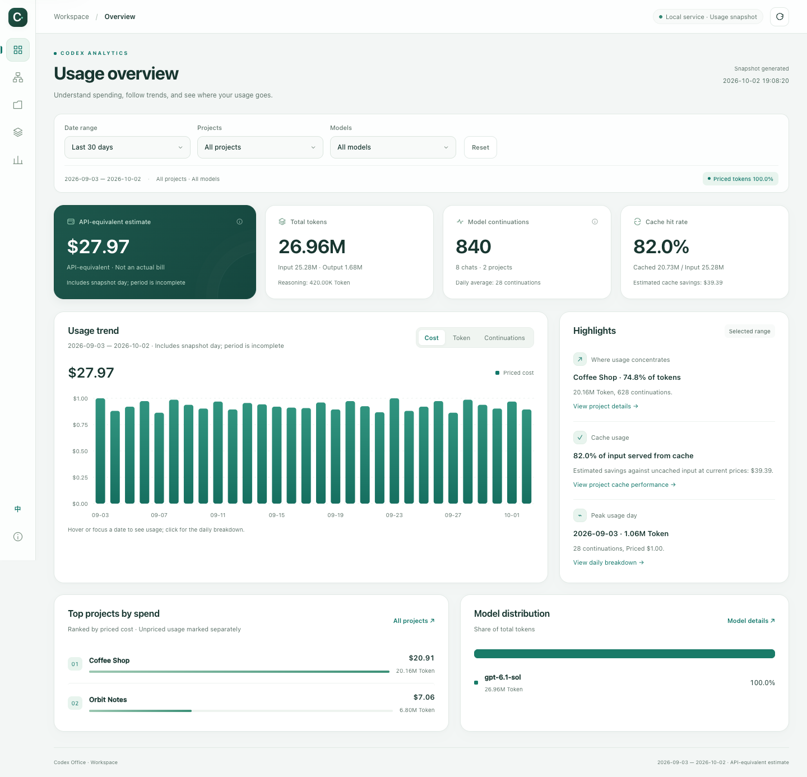

# Codex Office

> Watch your agents work. Know what the work costs.

[中文](README.md) · English · [User guide](docs/usage.en.md) · [Releases](https://github.com/kjwlegend/codex-office/releases) · [MIT](LICENSE)

**See AI collaboration, find work that needs your attention, and understand token usage in one workspace.**

Codex Office turns local Codex agents, chats and delegation into an interactive 3D office, then breaks usage down by project, model and time. When several tasks run in parallel, find the work you need to inspect. When reviewing a project, see where its resources went.

## Turn scattered collaboration into a visible office


Main agents, subagents and independent chats have their own coworkers and desks. Task bubbles, statuses and relationship links show how work is distributed, helping you follow a task's branches and understand collaboration across projects.

- **Find related work quickly:** search for a project or coworker, inspect its task and relationship chain, then open the original chat to continue.
- **Focus on work that needs attention:** the attention queue groups records awaiting confirmation or showing an issue, with locate, viewed and snooze actions to help you pick up where you left off.
- **Make coworkers recognizable and fun:** humans, cows and horses can join the office. Customize appearances, names, desk accessories and project colors to suit your workspace.
- **Choose how to observe:** a casual office, individual cells and a 2D relationship graph offer a spatial view, separate desks and a clear organizational structure.

## See where usage goes and make project reviews more useful



Tokens, cache hits and API-equivalent estimates share the same date, project and model filters. Move from totals to details to see which models a project used, how usage changed and how much input was reused through caching.

| Feature | What it helps you do |
| --- | --- |
| Usage overview | See tokens, estimated cost, cache hits and the main usage distribution together for the selected range. |
| Project rankings and details | Compare project usage, then inspect the dates and models contributing to one project. |
| Model analysis | Compare tokens, cost estimates and cache performance to understand each model's share of usage. |
| Trends and daily breakdowns | Follow changes over time and inspect the sources of usage on a particular day. |
| Multidimensional exploration | Investigate usage by time, working directory, agent role, reasoning effort and other dimensions. |

*Both previews use fictional projects, agents and usage data.*

## Bring existing records into your daily workflow

Build the workspace from Codex records already on your computer. Usage indexes and reports stay local. No additional API key, account registration or separate database service is required. Startup updates usage incrementally, and the running workspace can update it from the page. Reports support English, Chinese and offline viewing.

## Quick start

You need **Python 3.10+**, available timezone data, local Codex records and a modern browser. The 3D scenes use WebGL2; a 2D graph is also available.

Send [the repository link](https://github.com/kjwlegend/codex-office) to your Codex Agent and ask it to install and launch the app, or complete a fresh installation manually:

```bash
git clone https://github.com/kjwlegend/codex-office.git
cd codex-office
cp config.example.json config.json
python3 codex_usage.py serve --port 8766
```

Open [the local workspace](http://127.0.0.1:8766/codex-usage-report.html). Startup generates a report for the latest 30 days before serving the workspace. The first scan of historical records can take a while. Keep the terminal running and press `Ctrl+C` to stop.

The example uses the `Asia/Shanghai` timezone; adjust it as needed and reuse your existing `config.json` on later launches. After configuration, macOS users can also double-click `run-workspace.command` to open the office or `run-dashboard.command` to generate an offline report.

## Development and contributions

The project uses Python's standard library, plain HTML / CSS / JavaScript and locally bundled Three.js. Editable Blender character sources and 3D assets ship with the project. Contributions to collaboration views, usage analysis, interactions, localization and record compatibility are welcome.

[Tests and preview generation](tests/README.md) · [Blender asset authoring](assets/blender/README.md) · [Three.js build](dashboard/vendor/README.md)

## License

[MIT License](LICENSE). Three.js uses its [upstream MIT license](dashboard/vendor/three-LICENSE.txt). Codex Office is an independent community project with no official OpenAI affiliation.
