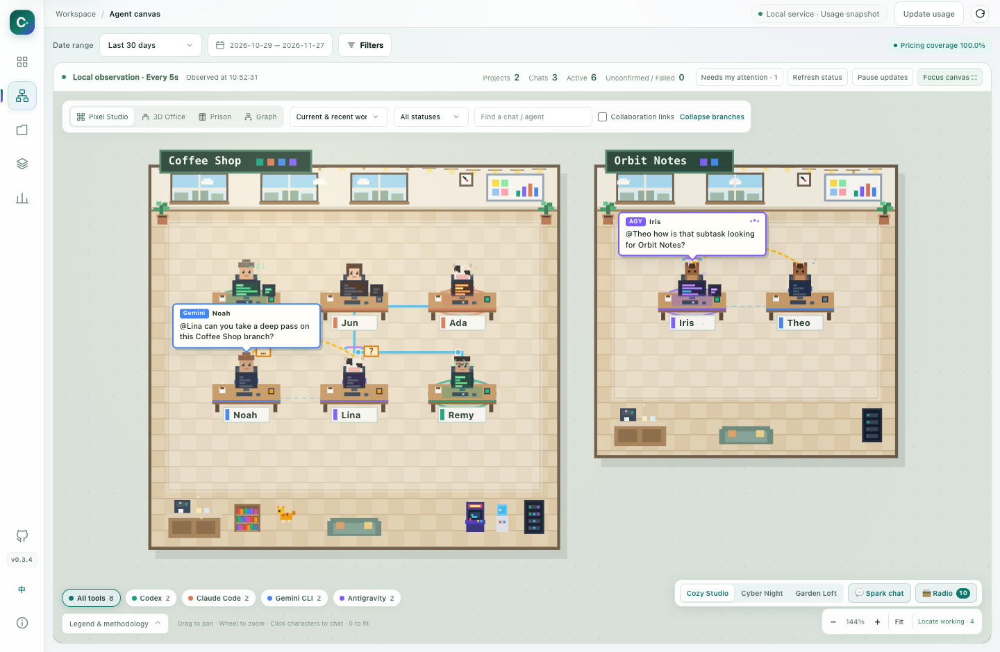
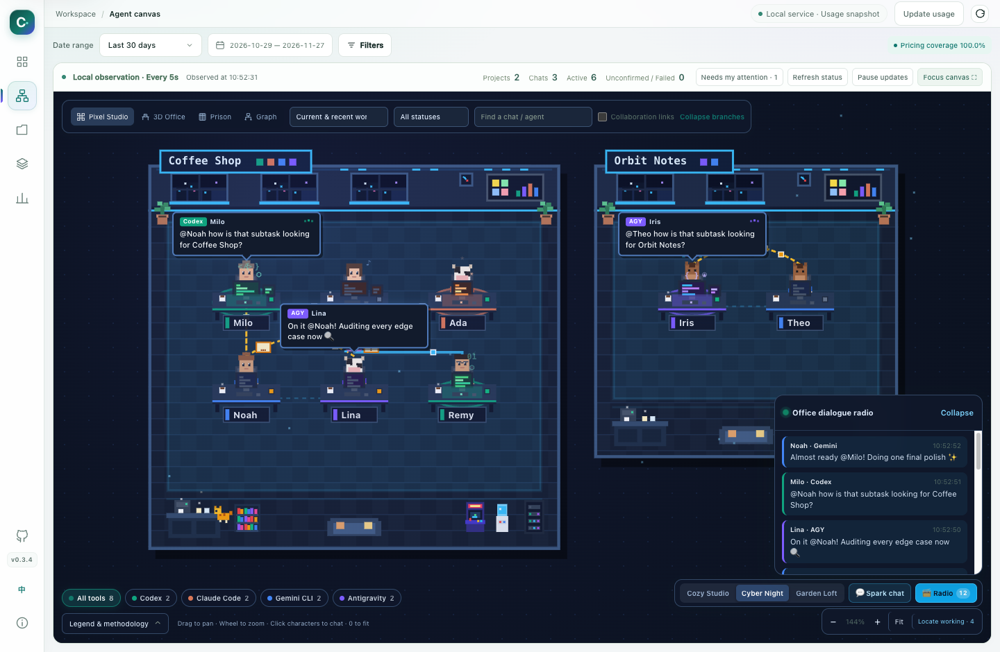
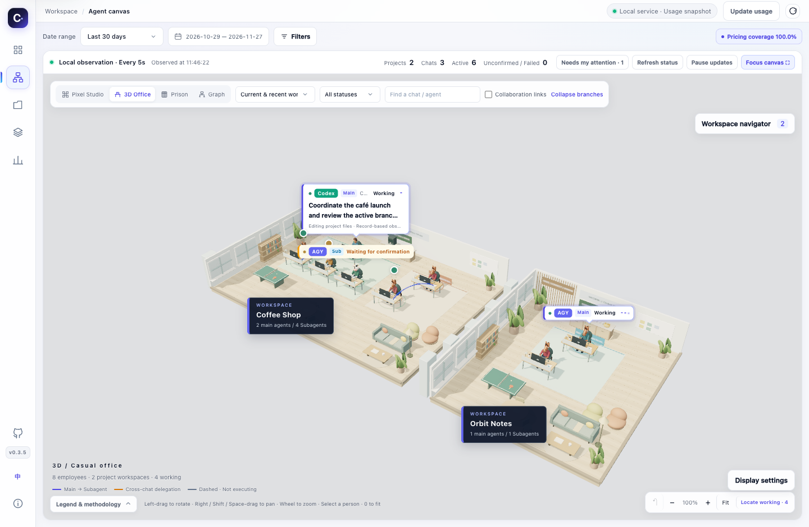
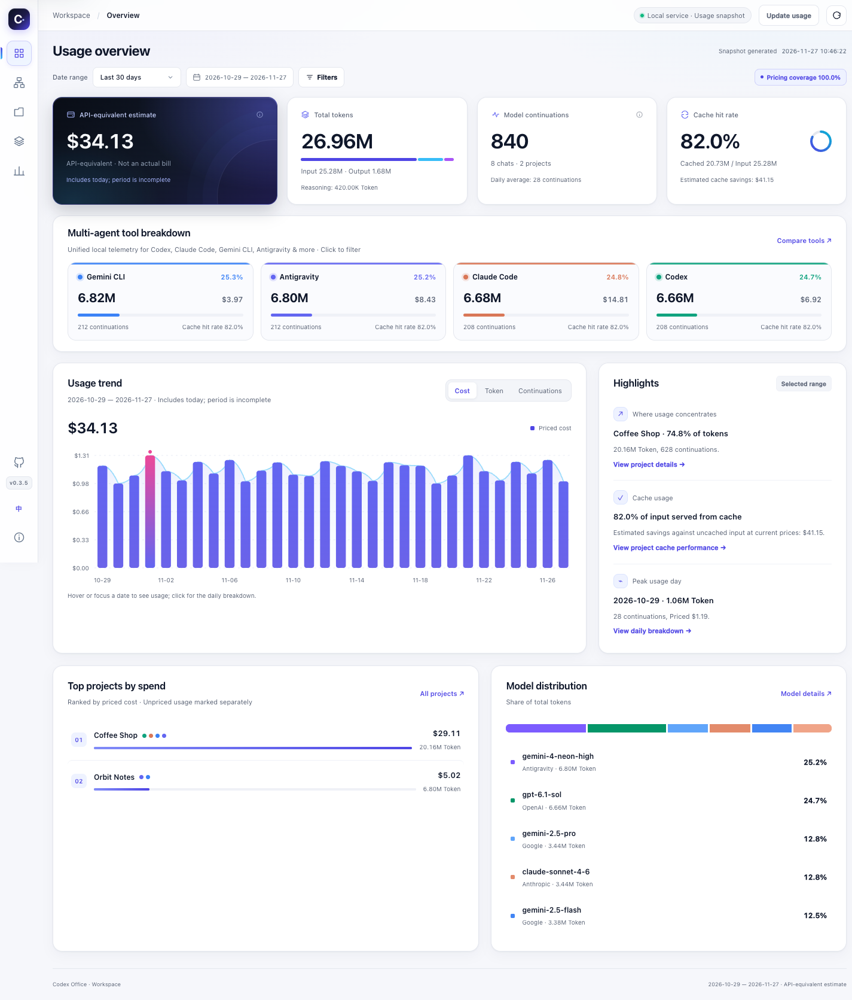

# Codex Office

> Watch your multi-tool AI agents work together. Know what every token costs.

[中文](README.md) · English · [User guide](docs/usage.en.md) · [Releases](https://github.com/kjwlegend/codex-office/releases) · [MIT](LICENSE)

**See AI collaboration across tools, spot tasks that need your attention, and track token spend in one local workspace.**

Codex Office automatically discovers local, read-only records from **Codex, Claude Code, Gemini CLI, Antigravity, Cursor, and OpenCode**, brings every agent, chat, and subagent into an interactive **2D Pixel Studio** and **3D Office**, and breaks down tokens, cache hits, and API-equivalent estimates by tool, project, model, and time.

## Supported AI Agent Tools

Local telemetry is automatically discovered at startup in strict read-only mode (no extra API keys, no sign-in, no cloud uploads, and conversation bodies are never stored):

| Agent Tool | Auto-discovered Path | Usage & Pricing Telemetry | Visual Office / Subagent Graph |
| --- | --- | --- | --- |
| **Codex** (OpenAI) | `~/.codex` (supports `CODEX_HOME`) | Tokens, cache reads, API-equivalent cost | Main agents, subagents, business delegation & `codex://` links |
| **Claude Code** (Anthropic) | `~/.claude`, `~/.config/claude` | Tokens, cache reads/writes, stream dedup & pricing | Main chats, subagents & role metadata |
| **Gemini CLI** (Google) | `~/.gemini` | Tokens, cache reads & pricing | Session activity & project mapping |
| **Antigravity** (Google) | `~/.gemini/antigravity`, `~/.gemini/antigravity-cli` | Tokens, cache reads, Neon/Hydrogen model pricing | Main sessions, subagent orchestration & live status |
| **Cursor** | `~/.cursor` | Local agent transcripts & tracking stats | Session activity & project mapping |
| **OpenCode** | `~/.local/share/opencode` | Local SQLite session & token telemetry | Session activity & project mapping |

## New 2D Pixel Studio: Multi-Agent Workspace & Character Conversations



The new **2D Pixel Studio** puts agents from every tool into color-coded outfits working side by side inside a lively pixel studio:

- **Three switchable pixel art themes:**
  - **Cozy Studio:** warm wood floor planks, Edison fairy string lights, drifting window clouds, steaming espresso bar, and a retro arcade cabinet.
  - **Cyber Night:** deep navy neon LED strips, starry skyline windows, glowing cyber effects, and a matching dark frosted HUD.
  - **Garden Loft:** light timber tiles, hanging botanical ivy with blossoms, and gently falling pixel petals.
- **Paired character dialogues & Office Radio:** coworkers spark bilingual paired banter grounded in real projects, models, and cross-tool handoffs (complete with golden signal arcs). Trigger new chats anytime with **Spark chat**, or open **Office dialogue radio** to browse live banter and click any entry to focus that character.
- **Playful studio details & effects:** floating anti-gravity halos for Antigravity agents, dual-monitor desks for main agents, customizable human/cow/horse pixel characters, live wall clocks, blinking server racks, flowing cable data packets, and an interactive roaming **office tabby cat**.
- **Multi-tool filter pills:** filter the studio floor by Codex, Claude Code, Gemini CLI, Antigravity, Cursor, or OpenCode in one click.



## 3D Office, Single Cells & 2D Relationship Graph



Alongside Pixel Studio, the workspace continues to ship upgraded **3D Office**, **Single cells (Prison)**, and **2D Graph** views—now enhanced with color-coded multi-tool chips, warmer studio lighting, adaptive quality, active-branch link tracing, a **Needs my attention** queue, and per-character visual customization.

## Modern Usage Analytics: Clear Multi-Tool Token Accounting



Refined through three full layout and aesthetic iterations, all six pages (Overview, Agent canvas, Projects, Models, Explore, Data & methodology) share a cohesive modern studio design, semantic provider colors, and synchronized date, tool, project, and model filters:

| Page | What it helps you do |
| --- | --- |
| **Overview** | Track API-equivalent cost, total tokens (with cached/uncached/output split bar), continuations, cache hit ring, **multi-agent tool breakdown** cards, and a spline-enhanced daily trend chart. |
| **Agent canvas** | Switch seamlessly between 2D Pixel Studio, 3D Office, Single cells, and 2D Graph to inspect cross-tool work, character banter, and items needing attention. |
| **Projects & details** | Review active project summaries, multi-tool pill badges, and sparklines, then drill down into per-project daily trends and model mix. |
| **Models** | Compare models across providers (OpenAI / Anthropic / Google / Antigravity) with semantic colors, token share bars, and main vs. subagent breakdown. |
| **Explore** | Start from 7 presets including **Tool comparison**, or combine **18 dimensions** (agent tool, provider, reasoning effort, weekday × hour heatmap, and more) across charts and tables. |
| **Data & methodology** | Check connection status and local paths for all 6 agent tools, pricing coverage, unpriced models, and exact calculation formulas. |

*All preview screenshots use fictional projects (Coffee Shop / Orbit Notes), invented agents, and synthetic usage data.*

## What's New in v0.3.4

- **Multi-agent tool integration:** unified read-only telemetry and pricing for Codex, Claude Code, Gemini CLI, Antigravity (IDE/CLI), Cursor, and OpenCode, including Anthropic Claude and Google Gemini / Antigravity Neon & Hydrogen pricing.
- **New 2D Pixel Studio:** Cozy Studio / Cyber Night / Garden Loft pixel themes, bilingual paired character conversations, collapsible Office Dialogue Radio, animated pixel studio decor, and an interactive office tabby cat.
- **3-round visual redesign:** refreshed typography, spacing, and visual hierarchy across all 6 pages with multi-agent tool cards, spline + peak-highlighted trend charts, project tool chips, and a 3×2 tool status grid—verified across English/Chinese and 320px/390px viewports.

## Quick start

You need **Python 3.10+**, available timezone data, and a modern browser. Startup automatically scans local records from installed agent tools in read-only mode. 3D scenes use WebGL2, while the default 2D Pixel Studio and 2D Graph work cleanly without WebGL2.

```bash
git clone https://github.com/kjwlegend/codex-office.git
cd codex-office
cp config.example.json config.json
python3 codex_usage.py serve --port 8766
```

Open [http://127.0.0.1:8766/codex-usage-report.html](http://127.0.0.1:8766/codex-usage-report.html). Startup incrementally scans usage and generates a 30-day report before serving the local workspace. Keep the terminal running and press `Ctrl+C` to stop.

The example uses the `Asia/Shanghai` timezone; adjust it as needed and reuse your existing `config.json` on later launches. After configuration, macOS users can also double-click `run-workspace.command` to open the office or `run-dashboard.command` to generate an offline report.

## Development and contributions

The project uses Python's standard library, plain HTML / CSS / JavaScript, and locally bundled Three.js, with fully portable offline HTML snapshots. Contributions to multi-tool adapters, pixel/3D visuals, analytics, and localization are welcome.

[Tests and preview generation](tests/README.md) · [Blender asset authoring](assets/blender/README.md) · [Three.js build](dashboard/vendor/README.md)

## License

[MIT License](LICENSE). Three.js uses its [upstream MIT license](dashboard/vendor/three-LICENSE.txt). Codex Office is an independent community project with no official affiliation with OpenAI, Anthropic, or Google.
