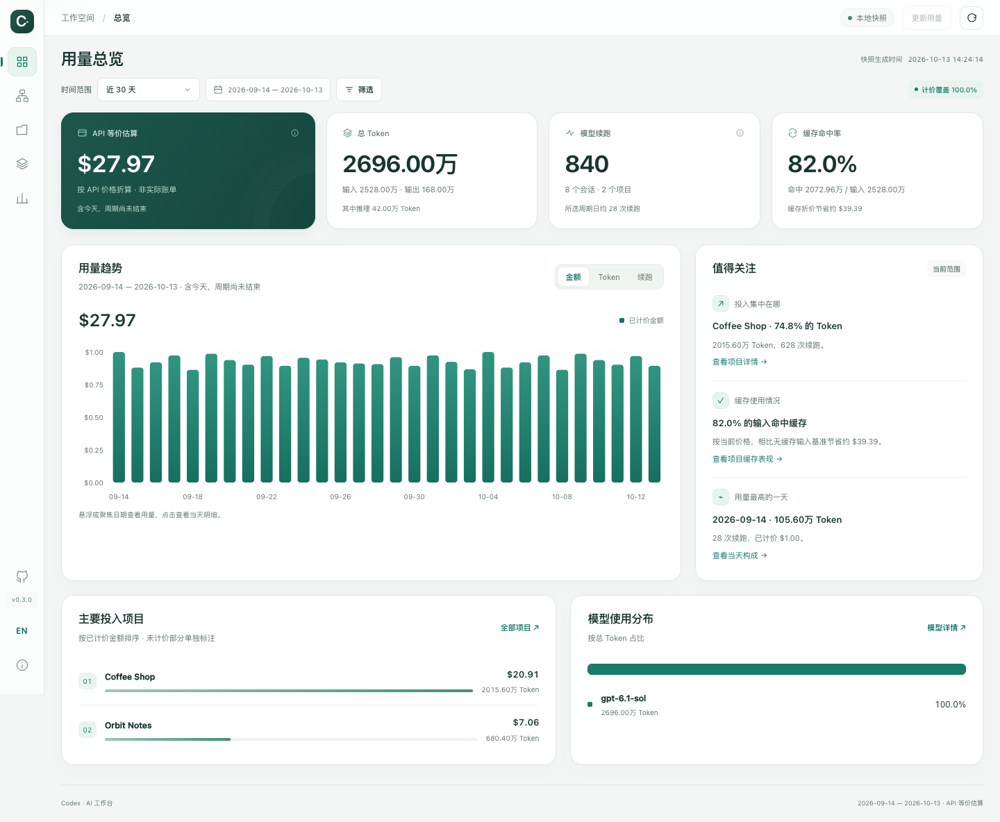

# Codex Office

> 看 AI 上班，算 Token 账。

中文 · [English](README.en.md) · [使用指南](docs/usage.zh-CN.md) · [MIT](LICENSE)

你的 Agent 已经在忙了。给它们一个能看见的办公室。

**Codex Office** 是一个本地优先的 Codex 工作观察台：一边把主 Agent、Subagents 和会话之间的委派关系放进可交互的 3D 办公室，一边把 Token、缓存命中和 API 等价成本整理成用量看板。打开浏览器，就能从“谁在做什么”看到“这份工作用了多少”。

无需 API Key，无需登录，也不会为了展示数据调用模型。Python 标准库负责本地服务与索引；Three.js 负责让同事们坐到工位上。


*所有预览图均来自虚构演示数据，不包含真实会话、项目或账单。人物动作是记录状态的可视化，不是屏幕录制。*

## 为什么做一个办公室

当你同时推进几个项目，终端和会话列表很难回答三个问题：

- **谁还在工作？** 哪个主 Agent 在推进任务，哪个分支在等待，哪个回合已经结束？
- **谁和谁是一组？** 哪些是真正的会话内 Subagents，哪些是另一个独立会话的业务委派？
- **消耗去了哪里？** 哪个项目、模型和时间段用了最多 Token，多少输入命中了缓存？

Codex Office 把这些信息放在同一个工作台里。它观察和解释本地记录，不接管你的 Agent，也不假装能读出尚未发生的结果。

## 两个视角，一个工作台

### 办公室：看协作

- **休闲办公室**：工位、会议区、咖啡吧、沙发、绿植和乒乓球桌。执行中的员工有敲键盘、查看屏幕、使用鼠标的动作，以及可辨认的辉光和任务气泡。
- **单人隔间**：同一批 Agent，换成更阴暗、带一点黑色幽默的空间。主题改变外观，不改变身份、权限或关系。
- **关系图**：需要更清晰的组织结构，或浏览器不支持 WebGL2 时，切换到二维图。
- 多项目同屏、分支默认展开、状态与搜索筛选、定位执行员工、悬浮详情、点选关系链和专注画布。
- 原生主 Agent → Subagent 关系与独立会话间的业务委派使用不同连线。业务层级可以在本地工作台调整，并带循环校验。
- 本地服务默认约每 5 秒观察一次记录；暂停、断线、过期和离线时停止活动动效。支持系统“减少动态效果”偏好。

### 看板：看投入



| 页面 | 能回答的问题 |
| --- | --- |
| 总览 | 所选范围用了多少 Token、多少次模型续跑，API 等价金额和缓存命中率是多少？ |
| Agent 画布 | 当前的 Agent 组织是什么样，谁近期有执行记录，所选范围内各节点用了多少？ |
| 项目 | 哪些项目投入最多，具体由哪些日期和模型构成？ |
| 模型 | 各模型的用量、计价覆盖和主 Agent / Subagent 分布如何？ |
| 探索分析 | 换成时间、工作目录、角色、推理等级等维度之后，分布有什么变化？ |
| 数据与口径 | 哪些用量未计价，指标怎么算，数据有哪些限制？ |

顶部时间、项目和模型筛选全局同步，包括顶部金额。每日趋势支持金额 / Token / 续跑切换；悬浮或键盘聚焦显示精确数值，点击日期可查看明细。探索分析提供 17 个统计维度、快捷视图、图表、分页表格和星期 × 小时热力图。

## 快速开始

### 准备条件

- **Python 3.10+**，以及可用的 IANA 时区数据。
- 现代浏览器；**WebGL2** 用于 3D 场景，不支持时可用关系图。
- 这台电脑上已有 Codex 本地记录。没有记录时不会凭空产生真实统计。

运行应用不需要 Node.js、npm、API Key 或数据库服务。macOS 上已做本地验证；其他系统可使用 Python 命令，具体 Codex 记录格式和浏览器兼容性仍需自行核对。

克隆仓库并启动：

启动方法：可以直接把[这个仓库链接](https://github.com/kjwlegend/codex-office)丢给你的 Codex Agent，让他安装并启动。

```bash
git clone https://github.com/kjwlegend/codex-office.git
cd codex-office
cp config.example.json config.json
python3 codex_usage.py serve --port 8766
```

**只在首次使用时复制配置，不要覆盖已有的 `config.json`。** 示例默认时区是 `Asia/Shanghai`；请先改成自己需要的统计时区。

打开 [本地工作台](http://127.0.0.1:8766/codex-usage-report.html)。`serve` 每次启动都会先增量扫描用量、生成最近 30 天的报表，再启动服务，无需另外配置定时任务。服务仅监听 `127.0.0.1`；保持终端运行，使用 `Ctrl+C` 停止。首次会扫描本地历史记录，历史较多时需要等待。

macOS 也可在完成配置后双击：

- `run-workspace.command`：更新用量、启动服务并打开 Agent 画布。
- `run-dashboard.command`：更新用量并打开离线看板。

双击启动受本机权限与系统安全设置影响，终端命令是通用入口。

### 第一次打开，建议这样逛

1. 在侧栏 **EN / 中** 切换语言，再选好顶部日期范围。
2. 看总览的金额、Token 和计价覆盖；有“未计价”时先看“数据与口径”。
3. 到 Agent 画布查看办公室，用“定位执行”找到近期有执行记录的员工。
4. 点选员工，查看主任务、模型、原生归属和业务关系；需要时打开原会话。
5. 到项目页看排行，再用探索分析切换维度，理解投入结构。

完整操作、配置、命令和排错见 [中文使用指南](docs/usage.zh-CN.md) / [English guide](docs/usage.en.md)。

侧栏 GitHub 图标直达[项目仓库](https://github.com/kjwlegend/codex-office)。点击版本号 **v0.3.0** 查看当前版本与最新正式 Release 的对比，或点击“检查更新”重试。版本号统一定义在 `app_version.py`。版本检查通过本地服务按需读取 GitHub 的公开发布信息；无 Release、断网和检查受限会分别提示。

员工详情中的“员工与工位自定义”可设置人类／奶牛／马、服装、显示昵称、桌面摆件和项目配色，保存于当前浏览器。“需要我处理”列出当前项目、模型筛选下最近 7 天的等待用户、失败、中断和待确认记录，支持定位、已查看、稍后 15 分钟及恢复；新状态或新活动会重新进入未处理列表。暂停／离线时显示最后记录。办公室、监狱及关系图均支持按住空格再拖动平移；输入框里的空格正常输入。

## 数据如何更新

**Agent 观察与 Token 看板不是同一个刷新过程。**

- 本地服务会周期性观察 Agent 记录。
- `serve` 启动时自动更新 Token 和金额快照；服务运行期间，浏览器刷新只读取文件，不重新扫描 Token。

每次启动默认更新最近 30 天，可以通过 `serve --days 7` 改变默认报表范围。需要直接使用已有报表、跳过启动更新时：

```bash
python3 codex_usage.py serve --port 8766 --no-refresh
```

更新失败时会保留原报表、提示错误并停止本次启动。已有服务运行时再次执行默认启动命令，也会更新报表并复用服务；重新载入页面即可看到新快照。

服务运行期间可点击右上角“更新用量”，增量扫描并生成新快照，完成后保留筛选重新载入。重复点击会复用同一更新任务，失败时保留原报表。也可在另一个终端运行：

```bash
python3 codex_usage.py dashboard --days 30
```

然后重新载入页面。快照包含执行时已经写入本地的记录，不固定截到前一天零点；日期按配置时区归属。“今天／昨天”按配置时区的真实日期计算；旧快照跨天后会提示更新。

只想应用页面或价格配置变化、暂不读取新增用量：

```bash
python3 codex_usage.py dashboard --days 30 --no-scan
```

需要服务持续运行时每日更新，可以选择自己的 Codex 定时任务或本机调度器，执行同一条更新命令。本仓库不会自动安装定时任务，后台观察也不会替你运行模型。

## 中英文支持

界面支持中文与英文即时切换，离线 HTML 也可使用。偏好保存在浏览器本地，并写入 URL fragment 的 `lang=zh-CN` / `lang=en`。切换会保留日期、项目、模型、页面和选中的 Agent。

仅翻译界面文案：项目名、会话标题、任务摘录和模型标识保留原文，不发送给翻译服务。英文紧凑数字采用 K / M / B，中文采用万 / 亿。

## 先说清楚，再算清楚

- **模型续跑不是 API 请求计数**：它是本地累计 Token 的一次正向增量，可能发生在使用工具之后，不等于用户任务数。重复快照和识别到的 fork 继承基线不会重复计入。
- **缓存命中不是本地缓存文件**：统计的是记录里的 `cached_input_tokens`，即服务端缓存读取 Token；同时提供输入 Token 命中占比和续跑命中比例。
- **API 等价金额不是套餐账单**：依据本地 `pricing.json` 的标准 API 价格快照折算，币种为 USD。推理 Token 属于输出，不重复收费；长上下文档位依据实际请求输入，而不是窗口容量。
- **没有价格不等于没有消耗**：未匹配价格的 Token 仍计入用量，金额标为未计价或部分未计价，不猜测单价。价格需要人工维护，不会自动联网更新。来源与最新单价请核对 [OpenAI 官方 API Pricing](https://developers.openai.com/api/docs/pricing)。
- **状态观察不是运行时确认**：近期未结束回合可以显示执行中；超过 5 分钟、缺少记录或存在时钟差异时显示待确认。“本轮结束”不等于业务完成、验收通过或代码已合并。
- **这不是控制台或历史录像**：不会发送任务、启动 / 停止 Agent、展示私有思考或提供真实完成百分比。日期筛选改变节点用量，不回放历史人员状态。

## 本地优先与隐私

默认读取 `~/.codex/sessions`、`~/.codex/archived_sessions` 及可用的本地会话 / 回合数据库；支持 `CODEX_HOME` 和 `--codex-home`。Codex 原始数据库始终只读，不依赖官方运行时订阅。

| 本地文件 | 用途 | 是否应该公开 |
| --- | --- | --- |
| `config.json` | 个人时区、项目识别与别名 | 否 |
| `.codex-usage/usage.sqlite3` | 用量增量索引与元数据 | 否 |
| `.codex-usage/agent-graph.sqlite3` | 工作台自己的业务层级，保存后才创建 | 否 |
| `codex-usage-report.html` | 包含个人元数据的离线快照 | 否 |
| `docs/images/` | 本仓库提供的虚构演示预览 | 可以 |

用量索引和离线报表不包含完整聊天正文。在线观察可在内存中提供经过尽力脱敏、最长 140 字符的当前请求摘录，不写入用量索引或离线快照。项目路径、会话标题、ID 和用量本身仍可能是敏感信息；不要把个人报表、截图或 API 响应发到公共仓库。

服务无账号系统，仅面向本机单用户。Host / Origin 校验与本机编辑令牌不等同于完整的多用户安全体系，**不要直接暴露到公网或给未信任的人共享服务**。`.gitignore` 已排除本地数据、配置、报表和开发产物，但发布前仍需检查实际提交内容。

## 开发与贡献

核心是 Python 标准库 + 原生 HTML / CSS / JavaScript。Three.js 与 OrbitControls 固定版本、本地打包后内联；生成的 HTML 不需要 CDN、外部字体或 3D 模型下载。

人物使用原创 Blender 骨骼模型、2K 布料贴图与远近 LOD，配合接触阴影、家具倒角和高 DPI 抗锯齿。项目导航可快速定位员工；右下角“显示设置”统一切换视角、任务标注、关系连线和自适应／精细／流畅画质。可编辑模型和重建方式见 [Blender 资产说明](assets/blender/README.md)；使用看板不需要安装 Blender。

```text
codex_usage.py          用量扫描、去重、聚合与计价
agent_graph.py          原生归属、业务关系与被动状态观察
workspace_server.py    仅本机的 HTTP 服务
dashboard_view.py      将界面与安全元数据内联为 HTML
dashboard/             六个页面、双语字典、共享侧栏与 3D 场景
tests/                 合成数据单元测试、浏览器回归与演示预览生成
docs/                  中英文使用指南与公开演示图
```

运行不读取真实账号数据的单元测试：

```bash
PYTHONDONTWRITEBYTECODE=1 python3 -m unittest discover -s tests -v
```

浏览器测试与预览图重建见 [测试说明](tests/README.md)；Three.js 重建见 [Vendor 说明](dashboard/vendor/README.md)。改页面源文件后重新生成 HTML，不直接维护会被下次更新覆盖的报表文件。

欢迎提交界面、可访问性、双语、记录兼容性和统计口径改进。反馈请附系统、Python / 浏览器 / Codex 版本、脱敏复现步骤或合成样例；不要附真实数据库、完整聊天或 API Key。行为变化应带测试，并同步中英文文档。

## 当前边界与规划

项目分组当前依据路径别名、Git 根目录及工作目录回退，不是 Codex 项目成员资格的权威来源。没有 Git 并不等于没有项目，独立会话也不等于 Subagent。

“自由工作区 / Unassigned workspace”及明确的未归属 / 待识别分类已进入设计讨论，**尚未实现**。本工具不覆盖没有落在当前本机记录中的远端 / 云端任务，也不是 ChatGPT 全账号用量平台。Codex 内部记录格式可能随版本变化，部分组织关系与状态可能无法确认。不提供 CSV 导出。

## 许可证与声明

[MIT License](LICENSE)。Three.js 保留 [上游 MIT 许可证](dashboard/vendor/three-LICENSE.txt)。

Codex Office 是独立的社区项目，与 OpenAI 不存在官方隶属或背书关系。Codex、OpenAI 等名称属于各自权利人。
