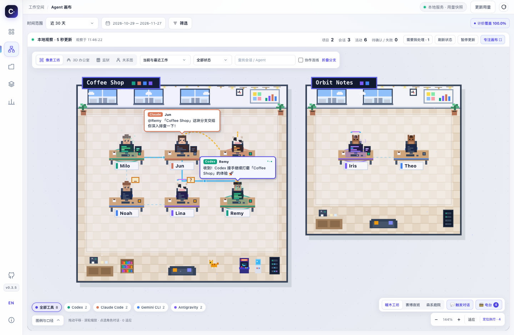
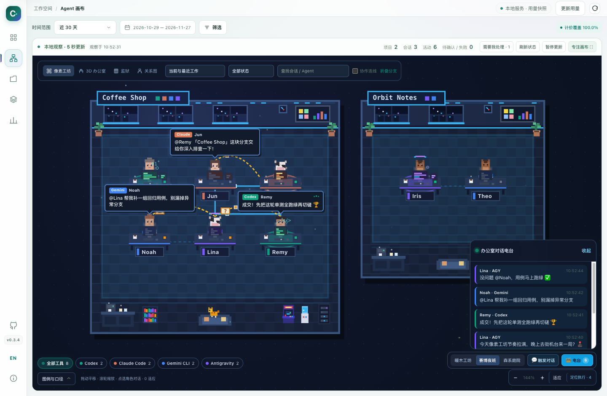
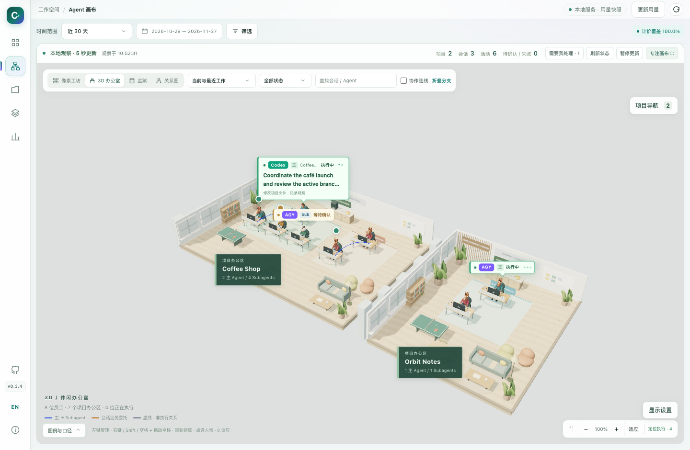
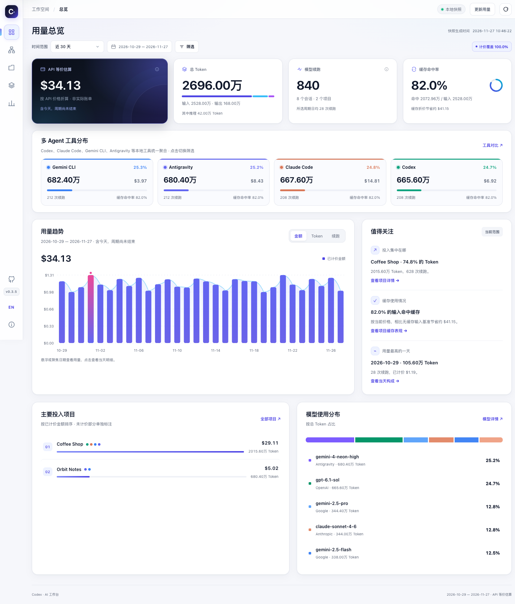

# Codex Office

> 看多端 AI Agent 同屋上班，把每一笔 Token 账算清楚。

中文 · [English](README.en.md) · [使用指南](docs/usage.zh-CN.md) · [版本下载](https://github.com/kjwlegend/codex-office/releases) · [MIT](LICENSE)

**在一个本地工作台里，统一聚合主流 AI Agent 工具的协作动态与 Token 用量——从 2D 像素工作室到 3D 办公室，让分散在终端与 IDE 里的 AI 同事清晰可见。**

Codex Office 以纯只读方式自动发现本机 **Codex、Claude Code、Gemini CLI、Antigravity、Cursor 与 OpenCode** 的本地记录，将多个 AI Agent、会话与子代理放进可交互的 **2D 像素工坊**与 **3D 办公室**，并按工具、项目、模型与时间维度给出透明可核对的 API 等价估算与缓存分析。

## 支持的 AI Agent 工具

启动时自动扫描以下本地工具记录（纯只读，无需额外 API Key、无需注册账号、不上传任何对话正文）：

| Agent 工具 | 自动发现路径 | 用量与计价统计 | 可视化办公室 / 子代理图谱 |
| --- | --- | --- | --- |
| **Codex** (OpenAI) | `~/.codex`（支持 `CODEX_HOME`） | Token、缓存读取、API 等价估算 | 主 Agent、Subagents、业务委派与 `codex://` 跳转 |
| **Claude Code** (Anthropic) | `~/.claude`、`~/.config/claude` | Token、缓存读/写、流式去重与计价 | 主会话、Subagents 与角色元数据 |
| **Gemini CLI** (Google) | `~/.gemini` | Token、缓存读取与计价 | 会话活动与项目映射 |
| **Antigravity** (Google) | `~/.gemini/antigravity`、`~/.gemini/antigravity-cli` | Token、缓存读取、Neon/Hydrogen 模型计价 | 主会话、Subagent 派发关系与实时状态 |
| **Cursor** | `~/.cursor` | 本地 Agent 转录与追踪数据统计 | 会话活动与项目映射 |
| **OpenCode** | `~/.local/share/opencode` | SQLite 会话与 Token 用量统计 | 会话活动与项目映射 |

## 全新 2D 像素工坊：多 Agent 同屋协作与角色对话



全新推出的 **2D 像素工坊（Pixel Studio）** 让不同工具的 AI 同事穿上各自配色制服，在同一间像素工作室里协同推进项目：

- **三套可切换像素画风**：
  - **暖木工坊（Cozy Studio）**：暖木地板、爱迪生小彩灯、飘云窗景、咖啡吧台蒸汽与复古街机台。
  - **赛博夜班（Cyber Night）**：深蓝霓虹灯带、星空夜景、赛博脉冲光效与深色毛玻璃 HUD。
  - **森系庭院（Garden Loft）**：清新木纹、垂藤樱花装饰与随风飘落的像素花瓣。
- **角色结对对话与办公室电台**：AI 同事会根据真实项目、模型与跨工具协作关系主动展开双语结对对话（附金色虚线信号光球弧线），可随时点击「触发对话」或展开「办公室对话电台」查看记录并一键聚焦对应角色。
- **生动细节与互动彩蛋**：Antigravity 角色自带悬浮反重力光环、主 Agent 配备双屏工位、人类 / 奶牛 / 马像素形象自由定制、机柜 LED 与实时像素挂钟动态运行，还有会自主巡逻并可点击互动的**办公室橘猫**。
- **多工具筛选条**：画布左下角一键按 Codex / Claude Code / Gemini CLI / Antigravity / Cursor / OpenCode 筛选工位。



## 3D 办公室、单人隔间与关系图



除像素工坊外，工作台继续保留并升级了 **3D 办公室**、**单人隔间（趣味监狱主题）** 与 **2D 组织关系图**，全面集成多工具彩色徽标、自适应画质、关系连线追踪、「需要我处理」待办队列与浏览器内外观自定义。

## 现代化用量看板：把每一笔多端 Token 账算清楚



经过三轮全站视觉与排版迭代，六个页面（总览、Agent 画布、项目、模型、探索分析、数据与口径）采用统一现代设计体系与供应商语义配色，共享同一组日期、工具、项目与模型筛选：

| 功能页面 | 核心价值 |
| --- | --- |
| **用量总览** | 一屏掌握 API 等价估算、总 Token（含缓存/输出微构成条）、模型续跑、缓存命中率环形图、**多 Agent 工具分布**卡片与带平滑曲线的每日趋势图。 |
| **Agent 画布** | 在 2D 像素工坊、3D 办公室、单人隔间和 2D 关系图之间无缝切换，实时追踪跨工具协作、角色对话与待确认任务。 |
| **项目投入与详情** | 展示活跃项目汇总、各项目使用的多工具胶囊标签与趋势微图，下钻查看单项目每日趋势与模型构成。 |
| **模型使用** | 按供应商语义配色（OpenAI / Anthropic / Google / Antigravity）对比模型用量、占比与主/子代理分工。 |
| **探索分析** | 内置「工具对比」等 7 个快捷视图，支持 **18 个维度**（含 Agent 工具、模型供应商、推理等级、热力图等）与图表/表格自由切换。 |
| **数据与口径** | 一览 6 大本地 Agent 工具接入状态与扫描目录，完整呈现计价覆盖率、未计价模型与透明计算公式。 |

*以上预览图均使用虚构项目（Coffee Shop / Orbit Notes）、虚构 Agent 与合成用量数据生成。*

## v0.3.4 主要更新

- **多 Agent 工具全量接入**：新增 Claude Code、Gemini CLI、Antigravity（IDE/CLI）、Cursor、OpenCode 统一采集与多供应商计价（Anthropic Claude / Google Gemini / Antigravity Neon & Hydrogen）。
- **全新 2D 像素工坊**：上线暖木工坊 / 赛博夜班 / 森系庭院三套像素主题、双语角色结对对话、办公室对话电台、像素家具动效与互动橘猫。
- **全站三轮视觉重构**：升级六大页面排版与现代卡片质感，新增多工具分布卡片、趋势曲线峰值高亮、项目多工具胶囊与 3×2 本地接入状态矩阵，同步完成中英文与 320px/390px 移动端适配。

## 快速开始

需要 **Python 3.10+**、可用的时区数据与现代浏览器。启动后会自动只读扫描本机已安装的 Agent 工具记录；3D 场景使用 WebGL2，默认 2D 像素工坊与关系图无需 WebGL2 即可流畅运行。

```bash
git clone https://github.com/kjwlegend/codex-office.git
cd codex-office
cp config.example.json config.json
python3 codex_usage.py serve --port 8766
```

打开 [http://127.0.0.1:8766/codex-usage-report.html](http://127.0.0.1:8766/codex-usage-report.html)。启动时会自动增量扫描并生成最近 30 天的报表，再提供本地工作台服务；保持终端运行，按 `Ctrl+C` 停止。

示例配置使用 `Asia/Shanghai` 时区，可按需要修改；再次启动时沿用已有的 `config.json`。macOS 用户完成配置后，也可双击 `run-workspace.command` 启动办公室，或用 `run-dashboard.command` 生成离线报表。

## 开发与贡献

项目使用 Python 标准库、原生 HTML / CSS / JavaScript 与本地打包的 Three.js，离线 HTML 同样完整可用。欢迎改进多工具适配、像素/3D 场景动效、报表分析与双语体验。

[测试与预览图生成](tests/README.md) · [Blender 资产制作](assets/blender/README.md) · [Three.js 构建](dashboard/vendor/README.md)

## 许可证

[MIT License](LICENSE)。Three.js 使用[上游 MIT 许可证](dashboard/vendor/three-LICENSE.txt)。Codex Office 是独立社区项目，与 OpenAI、Anthropic 或 Google 无官方隶属关系。
