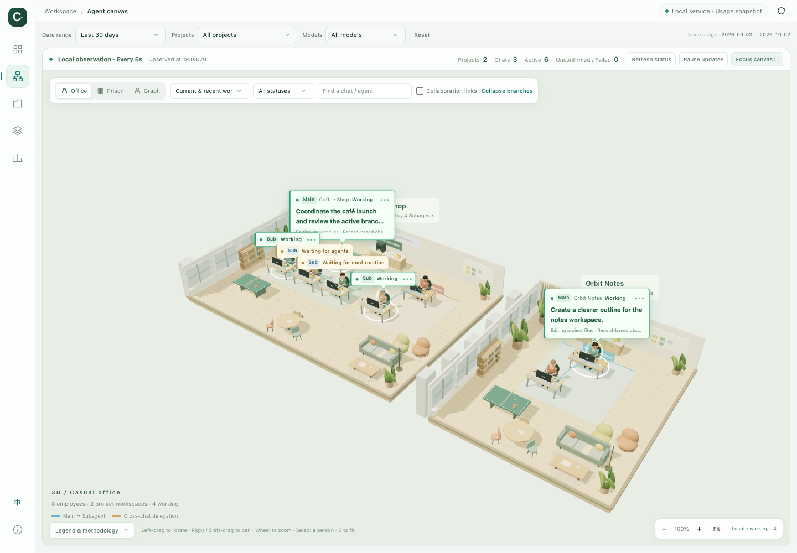

# Codex Office User Guide

[中文](usage.zh-CN.md) · English · [Back to the project](../README.en.md)

This guide covers setup, the six pages, the Agent office, refresh behavior, configuration, and troubleshooting. Run commands from the `codex-office` directory unless stated otherwise.

## 1. Start locally

Check your Python version:

```bash
python3 --version
```

Python 3.10+ is required. On first setup, copy the example configuration, edit the timezone, and start the service:

```bash
cp config.example.json config.json
python3 codex_usage.py serve --port 8766
```

Do not overwrite an existing configuration. Every `serve` launch scans usage and generates a report for the latest 30 days before starting HTTP; a separate HTML generation step is unnecessary even on first use. Open [http://127.0.0.1:8766/codex-usage-report.html](http://127.0.0.1:8766/codex-usage-report.html) and keep the service terminal running. The initial scan may take time; the terminal reports progress and newly indexed model continuations.

Records default to `~/.codex`. A configured `CODEX_HOME` changes that location. You can also pass the global argument explicitly:

```bash
python3 codex_usage.py --codex-home /path/to/your/.codex serve --port 8766
```

Replace example paths with real directories and quote paths containing spaces. Snapshot generation and the service should use the same Codex source.

### Local service versus an offline file

| Open mode | Usage analysis | Organization snapshot | Periodic observation | Edit workspace business hierarchy |
| --- | --- | --- | --- | --- |
| Local HTTP service | Yes | Yes | Yes | When the data is confirmed |
| Direct HTML file | Yes | Yes | No | No |

Offline HTML includes its resources and does not download fonts, scripts, or 3D models. Language and accounting filters still work, but characters do not play active-work effects and historical records are not represented as current observations.

## 2. Language, navigation, and global filters

The shared navigation rail contains Overview, Agent canvas, Projects, Models, Explore, and Data & methodology. Hover or keyboard-focus an icon to see its name. Narrow screens use top navigation.

Use **EN / 中** to switch language. The preference is local and the URL fragment carries `lang=en` or `lang=zh-CN`. This is not machine translation of your chats: project names, task excerpts, and other user content retain their original text.

Global filters offer Today, Yesterday, Last 7 / 30 / 90 days, All history, and custom dates, plus project and model filters. Custom ranges include both endpoints and apply when submitted. The headline cost, charts, rankings, and node usage change together.

All history means records available in the current local index, not all server-side activity since account creation. Today is anchored to the snapshot generation date. The default 30-day dashboard still performs full discovery and includes indexed historical analysis data; `--days 30` does not limit discovery to recently created files.

The page and filters persist in the URL fragment and normally survive a reload. Do not publicly share URLs containing private project names.

## 3. Read the usage dashboard

### Overview

Start with cost, tokens, continuations, and cache hits, then check pricing coverage. Unpriced means the cost estimate is incomplete, not that no tokens were used.

Daily trends switch between cost, tokens, and continuations. Hover or keyboard-focus a point for exact values; click a date to open its breakdown, then apply View this day only globally. Ranges longer than 120 days use monthly trend aggregation; tables retain exact data.

Comparisons use the immediately preceding equal-length period. An unfinished current day, insufficient prior records, or different pricing coverage can make comparisons unreliable. A trend arrow does not establish business efficiency.

### Projects

Sort by cost, tokens, or continuations, and search by project name. Open a project for daily trends, model contributions, and detailed rows; returning preserves list search and sorting.

Rankings show investment, not revenue, output quality, or ROI. Identical project names may be combined under the existing grouping rules. Use unique aliases or inspect Working directory in Explore to distinguish same-named folders.

### Models

Inspect usage, pricing coverage, and main-agent / subagent distribution. A global model selection affects the other pages. An unpriced model has no matching local price entry; that does not prove there is no official price.

### Explore

Start with a preset or choose a dimension, metric, and sort order manually. Switch between charts and paginated tables.

The 17 dimensions are project, model, project × model, date, month, weekday, hour, weekday × hour, working directory, main/subagent type, subagent role, source surface, originator, reasoning effort, Codex version, model provider, and context window.

Metrics include cost, total/input/output/cached/reasoning tokens, continuations, chats, cache-hit rates, unpriced usage, averages per continuation, and estimated cache savings. Group rates use aggregated counters, not a simple average of percentages. The heatmap shows usage patterns, not personal working hours.

### Data & methodology

Review pricing coverage, unpriced models, formulas, and snapshot notes for the selected range. Check this page before attributing an unexpected cost change to new consumption.

## 4. Use the Agent office



### Chats, main agents, subagents, and delegation

Each independent chat has its own main agent. Objects created inside that chat are subagents, which can have further native branches. Another independent chat still has its own main agent even when the first chat initiated it.

```text
Project
├─ Independent chat A · Main agent
│  ├─ In-chat subagent A1
│  └─ In-chat subagent A2
└─ Independent chat B · Main agent (business delegation from A)
   └─ In-chat subagent B1
```

A → B is a business relationship, not native subagent ownership. The canvas displays observed relationships and does not assume a fixed four subagents per chat. Missing relationships are not guessed from similar titles.

### Find the employee you need

1. Choose Casual office, Single cells, or Graph.
2. The default is current organization with branches expanded. To find older chats, choose the last 24 hours, last week, or all records.
3. Filter status or search. Locate working cycles through agents with recent work records in the current filters and expands their ancestors.
4. Hover for meaningful task context; select an employee to highlight relationships and inspect details. ID suffixes do not clutter the default scene.
5. Details include own usage, organization-branch totals, model, working directory, ownership, and the original chat link. Open original chat requires a Codex desktop app that handles `codex://` URLs.

Necessary ancestors remain as relationship context, so some visible nodes may not directly match the filter. Date filters change usage, while the observation window and current status have separate controls.

### 3D controls

| Action | Input |
| --- | --- |
| Rotate | Left-button drag / one-finger drag |
| Pan | Right-button or Shift drag / arrow keys |
| Zoom | Wheel / two-finger gesture / zoom buttons |
| Fit all | Fit button or keyboard `0` |
| More canvas space | Focus mode |
| Inspect an employee | Hover, keyboard focus, or select |

### What motion and status mean

| Recorded state | Visual expression |
| --- | --- |
| Working | Typing/screen review/mouse actions, glow, and task bubbles |
| Waiting for agents/user | Amber cues, not continuous execution |
| Turn ended | Active motion stops; this is not project completion or a merge |
| Failed/interrupted | Explicit status; no automatic task retry |
| Unconfirmed | Current status cannot be verified; not evidence of a stuck agent |
| Paused/offline/disconnected/stale | Active effects stop; last records remain with observation context |

Green flowing links describe recent downstream activity, not messages in transit. Historical collaboration links stay static. Bubbles show short request excerpts or titles plus recorded activity, not private reasoning, full commands, or tool output. At most four full bubbles are expanded in the macro view; this is not a subagent-count limit.

Status uses the latest local turn/activity records, observed approximately every 5 seconds by default. Unfinished records older than 5 minutes may become unconfirmed. Reduced-motion preferences stop continuous animation while retaining necessary static cues.

### Edit business hierarchy

Open Business orchestration in online details, choose a business parent, save, or restore automatic organization. Only independent chats can be business parents/children; native subagent ownership cannot be rewritten here. Cycles are rejected.

Saving writes only `.codex-usage/agent-graph.sqlite3`. It does not move projects, modify source chats, send instructions, or start/interrupt agents. Confirmed `create_thread` records provide default business delegation. Fork creation and historical collaboration are distinct from that default delegation. Manual organization can fill display gaps without inventing native relationships.

## 5. Refresh, offline use, and scheduling

The `serve` command updates usage at startup using the same configuration, prices, Codex source, index, and `--output` path. The default report covers the latest 30 days; adjust it with `--days` or `--start` / `--end`. The scan still checks all record files and reads changes incrementally, including older chats that continue producing usage.

To skip the startup update and use an existing HTML file:

```bash
python3 codex_usage.py serve --port 8766 --no-refresh
```

If the update fails, the previous HTML is retained, an error is printed, and this launch stops. A completed snapshot replaces the previous file atomically. Starting again while the service is already running updates the snapshot and reuses the service. Reload existing browser pages to see new usage. `--open` opens the local service page after the update completes. The macOS `run-workspace.command` uses this same flow without scanning twice.

To update usage while the service keeps running, run this in another terminal, then reload the page:

```bash
python3 codex_usage.py dashboard --days 30
```

The cutoff is the readable local records available when execution occurs, not the previous midnight. The app does not wait for or force remote data to be written. Reload report only reloads a snapshot.

`--no-scan` rebuilds a snapshot without collecting new tokens. It is useful after interface or pricing changes. A full scan may remove indexed records whose source files have disappeared, so the index is not a permanent account-history backup.

Startup updates need no scheduler. For daily updates while the service keeps running, you can optionally configure your own scheduler with the absolute project directory and run `python3 codex_usage.py dashboard --days 30`, without `--open`. The computer must be awake and the scheduler must be able to read Codex records and write the index/HTML. Check scheduler timezone separately from the reporting timezone in `config.json`. The repository installs neither a scheduled job nor a persistent process manager.

## 6. Configuration and pricing

### Project aliases and grouping

Example `config.json`:

```json
{
  "timezone": "Asia/Shanghai",
  "project_mode": "git",
  "project_aliases": {
    "/path/to/projects/cafe-web": "Coffee Shop",
    "/path/to/notes": "Orbit Notes"
  }
}
```

Aliases take precedence, with the most specific path prefix first. Git mode uses the nearest Git root and collapses recognized worktrees. Missing Git roots or inaccessible directories fall back to the working directory; this is not authoritative project membership. `cwd` mode skips Git-root lookup but still applies aliases. Regenerate the snapshot after changing aliases and restart an existing service to reload its configuration.

### Changing timezone

Timezone determines date, hour, and weekday grouping. Choose it before first indexing. Historical local dates are stored in the index and do not migrate automatically after a configuration change. Preserve the old index and fully rebuild a new one:

```bash
python3 codex_usage.py --db .codex-usage/usage-new-timezone.sqlite3 dashboard --days 30
```

Keep using the same `--db` when generating/querying that index. Systems without a timezone database may need Python's `tzdata` package or an available IANA timezone; this is separate from date filters.

### API-equivalent estimates

`pricing.json` holds a snapshot date, sources, model aliases, and ordinary/long-context tiers. Rates are USD per million tokens.

```text
Ordinary input = max(input tokens − cache-read tokens − cache-write tokens, 0)

API-equivalent cost = (
    ordinary input × input rate
  + cache reads × cached_input rate
  + cache writes × cache_write rate
  + output × output rate
) / 1,000,000
```

Read/write counts are bounded by input to avoid double counting. A missing separate cache-write rate falls back to the ordinary input rate. Reasoning is part of output and is not added again. Long-context pricing applies only when configured for the model and actual request input exceeds the configured threshold, not because the context window is large.

```text
Token cache-hit rate = cache-read tokens / input tokens
Continuation hit share (UI request hit rate) = continuations with cache reads / all continuations
```

Estimated cache savings compare all-input-at-ordinary-rate cost with the recorded input categories; they are not cash saved on a subscription. The theoretical additional saving ceiling assumes all input could be cached and is not a guaranteed optimization.

Prices are not automatically fetched. Check [official OpenAI API Pricing](https://developers.openai.com/api/docs/pricing) and model documentation, update sources/dates/rates, then regenerate with `--no-scan`. A local Standard API snapshot reprices the indexed usage uniformly; it does not reconstruct historical transaction prices or include subscription allowances, taxes, Fast/Batch differences, separate tool fees, or other charges.

## 7. Command reference

Place global options `--codex-home`, `--db`, `--config`, and `--pricing` before the subcommand.

```bash
# Full incremental discovery/indexing, without generating HTML
python3 codex_usage.py scan

# Last 7 days as a terminal table; scans new records by default
python3 codex_usage.py report --days 7

# Inclusive explicit date range
python3 codex_usage.py report --start 2026-09-01 --end 2026-09-30

# JSON from the existing index, inside the ignored local data directory
python3 codex_usage.py report --days 30 --no-scan --format json --output .codex-usage/summary.json

# Rebuild from the existing index and open an offline snapshot
python3 codex_usage.py dashboard --days 30 --no-scan --open

# Custom port and observation interval (2–60 seconds)
python3 codex_usage.py serve --port 8767 --refresh-seconds 10

# Update the default report for the latest 7 days at startup
python3 codex_usage.py serve --days 7 --open

# Full help
python3 codex_usage.py --help
python3 codex_usage.py dashboard --help
python3 codex_usage.py serve --help
```

For a quick first look, use `dashboard --days 30 --quick-scan`. It discovers files created in the selected period and may miss older chats still producing usage. `scan --days 30` has a similar limitation. Omit these quick-range options when completeness matters.

For a custom HTML path, use `serve --output /path/to/report.html` to generate and serve the report there. With `--no-refresh`, that file must already exist. The browser endpoint remains `/codex-usage-report.html`. Terminal table and JSON output are supported; CSV export is not.

## 8. Troubleshooting

| Symptom | Check first |
| --- | --- |
| Configuration error / missing config | Initial example copy, valid JSON, and an available timezone |
| No new usage | Run default serve or dashboard, then reload; check generation time and omit --no-refresh / --no-scan |
| Empty dashboard | Correct Codex path, local records, and old date/project/model filters in the URL |
| Empty Agent canvas | Readable chat database; try last 24 hours/all records and broader status/project filters |
| Tokens but no cost | Model price matching, aliases, and unpriced usage in Data & methodology |
| Black/unavailable 3D | WebGL2 support; use Graph rather than assuming data is missing |
| No character motion | Paused, offline, stale, disconnected, reduced-motion, or ended-turn state |
| Port occupied | The same workspace may already be running; otherwise use `--port 8767`, not a forced kill |
| Cannot save hierarchy | Local service, confirmed data, independent-chat identities, and no cycle |
| Missing data after a Codex upgrade | Internal format changes; report redacted versions/warnings or synthetic examples, not real databases |

The [local health endpoint](http://127.0.0.1:8766/api/health) confirms service responsiveness, not complete pricing, records, or relationships.

## 9. Safe publishing and development

Before publishing, review `git status --short`, candidate files, and diffs. Never force-add ignored personal configuration, databases, generated reports, screenshots, full chats, or environment files. Use the synthetic generator in [test instructions](../tests/README.md) for public previews; that is how the included `docs/images/` were made.

Interface source is in `dashboard/`, the language catalog in `dashboard/i18n.js`, and HTML inlining in `dashboard_view.py`. Run synthetic unit tests:

```bash
PYTHONDONTWRITEBYTECODE=1 python3 -m unittest discover -s tests -v
```

See [test instructions](../tests/README.md) and [vendor instructions](../dashboard/vendor/README.md) for browser checks, demo capture, and rebuilding third-party assets. Unassigned workspace remains planned; previews and design proposals are not claims of implemented functionality.
