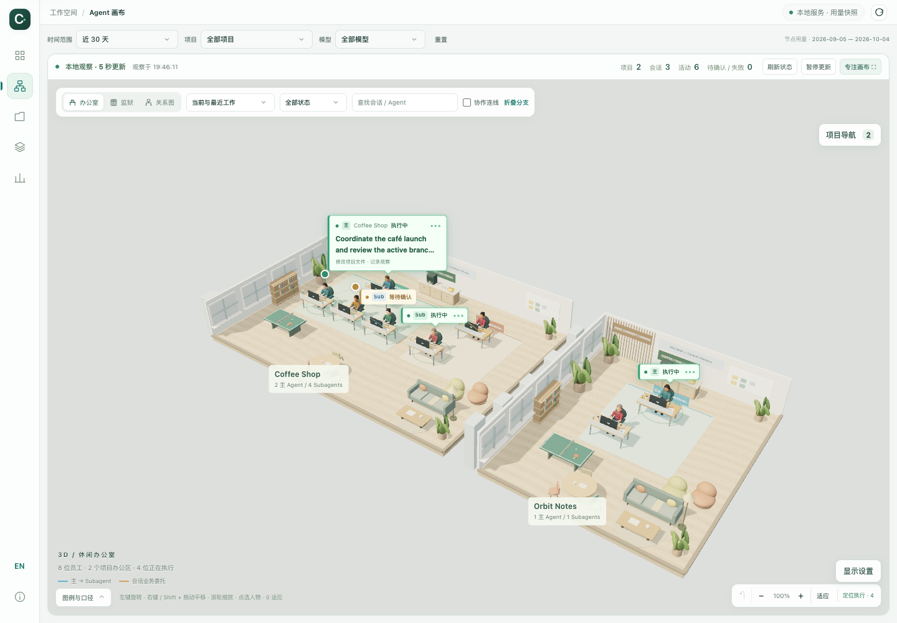

# Codex Office 使用指南

中文 · [English](usage.en.md) · [返回项目介绍](../README.md)

这份指南介绍安装、六个页面、Agent 办公室、刷新、配置与排错。所有命令都在 `codex-office` 项目目录执行，除非特别说明。

## 1. 先完成本地启动

确认 Python 版本：

```bash
python3 --version
```

需要 Python 3.10+。首次使用时复制示例配置，编辑时区，再启动服务：

```bash
cp config.example.json config.json
python3 codex_usage.py serve --port 8766
```

已有配置时不要再次覆盖。`serve` 会在每次启动时先扫描用量并生成最近 30 天的报表，完成后再启动 HTTP 服务；首次使用也无需单独生成 HTML。打开 [http://127.0.0.1:8766/codex-usage-report.html](http://127.0.0.1:8766/codex-usage-report.html)，保持启动服务的终端运行。首次扫描可能较慢，终端会输出扫描进度和新增模型续跑数量。

本地记录默认来自 `~/.codex`。如果设置了 `CODEX_HOME`，会使用该位置；也可通过全局参数显式指定：

```bash
python3 codex_usage.py --codex-home /path/to/your/.codex serve --port 8766
```

路径是占位示例，替换为真实目录；有空格的路径要加引号。生成快照和启动服务应使用同一份 Codex 数据来源。

### 本地服务与离线文件

| 打开方式 | 用量分析 | Agent 组织快照 | 周期观察状态 | 修改工作台业务层级 |
| --- | --- | --- | --- | --- |
| 本地 HTTP 服务 | 支持 | 支持 | 支持 | 数据可确认时支持 |
| 直接打开 HTML | 支持 | 支持 | 不支持 | 不支持 |

离线 HTML 自带资源，不需要联网下载字体、脚本或 3D 模型。离线时仍能切换语言和筛选统计，但人物不播放“正在执行”的动效，也不能把历史快照当成当前状态。

侧栏 GitHub 图标打开项目仓库，版本号按钮显示当前 **v0.3.0** 并展开更新检查。打开面板时，本地服务按需读取 GitHub 最新正式 Release，显示新版本、已是最新、当前版本更高或尚未发布；“检查更新”可重试。普通报表浏览与离线文件不会发起版本检查。查询只使用公开仓库地址和应用版本，不发送本地会话或用量记录。

## 2. 语言、导航与全局筛选

共用侧栏提供总览、Agent 画布、项目、模型、探索分析和数据与口径六个入口。悬浮或键盘聚焦图标可查看名称；窄屏改为顶部导航。

点击 **EN / 中** 切换界面语言。浏览器保存语言偏好，URL fragment 也包含 `lang=en` 或 `lang=zh-CN`；不是机器翻译你的聊天内容。项目名、任务摘录等保留原文。

顶部筛选可以选择今天、昨天、近 7 / 30 / 90 天、全部历史和自定义日期，同时筛选项目、模型。自定义范围包含起止两天，点击应用后生效。顶部 API 等价金额、图表、排行和画布节点用量同步变化。

“全部历史”指当前本地索引中可获取的记录，不是账号创建以来的全部服务器数据。预设里的“今天／昨天”按配置时区的真实日期计算；数据仍以用量快照时间为准。生成默认 30 天视图时，完整扫描仍会建立可用历史索引，并将历史分析数据带入页面；`--days 30` 不代表只扫描近 30 天的文件。

页面、日期和筛选保存在 URL fragment，重新载入通常会保留。不要公开分享包含个人项目名的完整 URL。

报表顶部采用紧凑范围工具栏：日期预设直接选择，点击日期摘要编辑开始／结束日期；项目和模型在“筛选”面板中修改。已选范围、筛选数量、计价覆盖保持可见，日期编辑和筛选面板关闭后不占据报表高度。按 Escape 或点击外部可关闭，刷新／跨页保留已应用的筛选。

## 3. 用量看板怎么读

### 总览

先看当前范围的 API 等价金额、总 Token、模型续跑和缓存命中，再看价格覆盖。未计价提示意味着金额不完整，不是 Token 为零。

每日趋势可切换金额 / Token / 模型续跑。悬浮或键盘聚焦查看精确数值；点击日期打开当日明细，再用“仅查看这一天”应用到全局。范围超过 120 天时趋势按月聚合，精确数据可到表格查看。

比较使用相邻的前一个等长周期。当天尚未结束、前期记录不足、计价覆盖不一致等情况会限制可比性。对比箭头不是业务效率结论。

### 项目

按金额、Token 或续跑排序，搜索项目名称。点击项目进入详情，查看每日趋势、模型贡献和明细，返回时保留列表的搜索与排序。

排行展示的是投入，不是项目收入、产出质量或投资回报。相同项目名称可能按现有口径归并；需要区分同名目录时，配置唯一别名，或在探索分析中看工作目录。

### 模型

查看模型用量、计价覆盖和主 Agent / Subagent 分布。切换顶部模型筛选后，其他页面同步更新。一个模型标为未计价，只说明当前本地价格快照没有匹配项，不代表官方一定没有价格。

### 探索分析

先选快捷视图，也可自由组合维度、指标和排序，在图表与分页表格之间切换。

当前支持 17 个维度：项目、模型、项目 × 模型、日期、月份、星期、小时、星期 × 小时、工作目录、主 / 子代理、子代理角色、来源入口、发起端、推理等级、Codex 版本、模型供应商、上下文窗口。

指标包括金额、总 / 输入 / 输出 / 缓存 / 推理 Token、模型续跑、会话数、缓存命中率、未计价用量、平均每次 Token 与金额、缓存节省估算等。分组命中率由分组汇总数计算，不是各行百分比的简单平均。热力图适合观察使用时段，不用于判断个人工作时长。

### 数据与口径

查看当前筛选下的价格覆盖、未计价模型、公式和快照说明。金额变化异常时，先核对这里，再判断是否确有新增消耗。

## 4. Agent 办公室怎么用



### 会话、主 Agent、Subagent 与业务委派

一个独立会话拥有自己的主 Agent；它在会话内创建的对象称为 Subagent，Subagent 也可能继续派生分支。另一个独立会话即使由前者发起，里面的 Agent 仍是它自己的主 Agent。

```text
项目
├─ 独立会话 A · 主 Agent
│  ├─ 会话内 Subagent A1
│  └─ 会话内 Subagent A2
└─ 独立会话 B · 主 Agent（业务上由 A 委派）
   └─ 会话内 Subagent B1
```

A → B 是业务关系，不会把 B 变成 A 的原生 Subagent。画布按观察到的实际关系展示，不预设每个会话固定有 4 个 Subagents；关系不完整时不根据标题相似度猜测。

### 找到你关心的员工

1. 选择办公室、单人隔间或关系图主题。
2. 默认查看当前组织，分支展开。需要找较早会话时，切换最近 24 小时、近一周或全部记录范围。
3. 使用状态筛选或搜索；“定位执行”会依次定位当前筛选内有近期执行记录的员工，并展开其祖先分支。
4. 悬浮查看有意义的任务说明，点选查看关系链和详情；默认不会用人物 ID 尾号塞满场景。
5. 详情中可查看自身用量、组织分支合计、模型、工作目录、归属和原会话入口。“打开原会话”需要支持 `codex://` 的 Codex 桌面应用。

筛选会保留必要的祖先节点作为“关联结构”，所以画布可能出现不直接匹配筛选、但用于解释归属的节点。日期只筛选用量；画布观察范围与当前状态另有自己的控制。

### 3D 操作

| 操作 | 方式 |
| --- | --- |
| 旋转 | 左键拖动 / 单指拖动 |
| 平移 | 右键拖动、Shift 或空格 + 拖动 / 键盘方向键 |
| 缩放 | 滚轮 / 双指手势 / 页面缩放按钮 |
| 适应全部 | 适应按钮或键盘 `0` |
| 返回上一视角 | 右下角 `↶`；画布聚焦时按 `B` |
| 减少界面占用 | 专注画布 |
| 查看员工 | 悬浮、键盘聚焦或点选 |
| 快速定位 | 点击办公区名称，或打开右上角“项目导航”选择项目 / 员工 |
| 视角 | 右下角“显示设置” → 等距总览 / 俯视布局 / 工位近景 |
| 任务标注 | “显示设置” → 自动疏密 / 仅检查时 / 更多任务 |
| 连线 | “显示设置” → 全部关系 / 活动分支 / 检查时显示 |
| 画质 | “显示设置” → 自适应画质 / 精细画质 / 流畅画质，自动记住选择 |

画布聚焦时，`V` 循环切换视角，`N` 打开项目导航并聚焦搜索框，`/` 聚焦画布的 Agent 筛选框；在输入框内输入这些字符不会触发快捷键。视角历史仅保存在当前页面内，最多 12 次定位／预设切换；切换场景或重排可见结构后会清空。返回只恢复相机，不撤销筛选、详情选择或业务层级。

大团队自动排成较紧凑的工位区，办公区按尺寸排列；状态变化不会单独触发布局重排。等待中的员工同样可以展开任务，靠近边缘或面板的标注会避让或简化；偏移较大的任务气泡以细引线连接原位置。

项目名使用深色办公区标牌，与员工任务气泡区分；点击仍可定位项目。达到 48 名员工后，屏幕尺寸较小的远景工位和人物会自动批量绘制，收起个人气泡与未检查的关系线。放大、悬浮、选择或通过项目导航定位时恢复对应员工的模型与任务。视野外人物暂停更新，总览静止时停止连续渲染；员工身份、导航名单、筛选与统计保持不变。

默认自适应画质：人数较多的远景降低渲染开销，拉近时恢复精细效果。它根据可见人数和相机距离切换，不是帧率保证；已有手动画质偏好继续保留。精细画质使用高 DPI 抗锯齿、接触阴影、环境反射和 Blender 骨骼人物；流畅画质降低渲染比例并关闭接触阴影。人物细节仍根据屏幕尺寸切换，拥挤场景也能拉近查看完整模型。模型和 2K 布料贴图内置于 HTML，不需要安装 Blender 或联网下载；切换画质不改变相机位置、Agent 身份或统计数据。

“项目导航”列出当前筛选和展开范围内的员工，不代表全部历史会话。点击项目定位办公区；点击员工打开其真实详情。离线或暂停时只显示最后记录。手动调整后的相机视角在状态刷新时保留；切换场景或点击“适应”仍会重新取景。“工位近景”优先定位已选员工，否则定位正在执行的员工。“适应”会从近景回到等距总览。

导航内可以搜索项目名、员工名、会话标题和可见任务摘录；“正在执行”与“需要关注”只筛选导航列表，不改变画布和统计。“需要关注”包括等待用户、待确认、失败或中断，不等于任务失败。暂停、离线或记录过期时，不将最后记录列为当前执行或当前关注对象；切回“全部员工”可查看最后记录。未匹配时可一键清除导航筛选。

标注和关系显示只改变视觉密度，不改变筛选、统计或归属。拥挤标注可收成状态点，悬浮或键盘聚焦仍能查看任务；“检查时显示”沿当前员工展示关联分支。项目导航与显示设置按需展开，按 `Escape` 可关闭并返回入口。

员工详情中的“员工与工位自定义”可设置人类／奶牛／马、服装、显示昵称、桌面摆件和项目配色，保存于当前浏览器。“需要我处理”列出当前项目、模型筛选下最近 7 天的等待用户、失败、中断和待确认记录，支持定位、已查看、稍后 15 分钟及恢复；新状态或新活动会重新进入未处理列表。暂停／离线时显示最后记录。办公室、监狱及关系图均支持按住空格再拖动平移；输入框里的空格正常输入。

### 动画和状态的含义

| 记录状态 | 画布如何表达 |
| --- | --- |
| 执行中 | 员工打字 / 看屏幕 / 使用鼠标，配辉光和任务气泡 |
| 等待代理 / 用户 | 琥珀色提示，不冒充持续执行 |
| 本轮已结束 | 停止执行动作；不代表项目完成或代码已合并 |
| 失败 / 中断 | 明确状态提示，不自动重试任务 |
| 待确认 | 无法确认当前状态，不据此断言卡住 |
| 暂停 / 离线 / 断线 / 过期 | 停止活动动效，保留最后记录并说明观察状态 |

绿色流动连线表达下游分支的近期执行记录，不表示消息正在传输。历史协作线保持静止。任务气泡只展示短摘录或标题与已记录活动，不展示内部思考、完整命令或工具输出。自动标注在远景通常展开 1 个、近景最多 3 个任务；“更多任务”最多自动展开 4 个。正在检查的员工会额外展开，这不是 Subagent 数量限制。

状态来自本地最新回合与活动记录，默认约每 5 秒观察一次。超过 5 分钟的未结束记录可能变成待确认。系统减少动态效果偏好会停止连续动画，保留必要的静态状态提示。

### 调整业务层级

在在线详情的“业务编排”中选择业务上级，保存，或恢复自动。仅独立会话可以参与业务上下级，原生 Subagent 归属不能在这里改写；形成循环的关系会被拒绝。

保存只写入本工具的 `.codex-usage/agent-graph.sqlite3`。不会移动项目、修改原始会话、发送指令或启动 / 中断 Agent。可确认的 `create_thread` 记录用于默认业务委派；fork 发起记录和历史协作不等同于该默认委派。没有完整记录时可手动整理，而不是伪造原生关系。

## 5. 更新、离线与定时执行

启动命令 `serve` 默认自动更新用量，使用相同的配置、价格、Codex 数据来源、索引和 `--output` 路径。默认报表范围是最近 30 天，可用 `--days` 或 `--start` / `--end` 调整。扫描仍会检查全部记录文件，并增量读取变化，包含更早创建、现在仍在续跑的会话。

需要跳过启动更新、直接使用已有 HTML 时：

```bash
python3 codex_usage.py serve --port 8766 --no-refresh
```

更新失败会保留原 HTML、输出错误并停止本次启动。新快照完整写入后才替换旧文件；已有服务运行时再次启动，会更新快照并复用服务。已有浏览器页面需重新载入，才会显示新用量。`--open` 在更新完成后打开本地服务页面。macOS 的 `run-workspace.command` 使用同一流程，不会重复扫描。

服务运行期间可点击右上角“更新用量”，增量扫描并生成新快照，完成后保留筛选重新载入。重复点击会复用同一更新任务，失败时保留原报表。也可在另一个终端运行，然后重新载入页面：

```bash
python3 codex_usage.py dashboard --days 30
```

统计截止到执行时可读、已写入本地的记录，而不是前一天零点。不会等待或强制刷新尚未落盘的远端数据。“重新载入报表”只重读快照。

`--no-scan` 只重建快照，不获取新增 Token。适合改界面或价格后重新计算；如果源文件被删掉，完整扫描也可能从索引中移除相应记录，因此它不是永久的账号历史备份。

启动时更新无需定时任务。若需要服务持续运行期间每天更新，可在自己的调度器里固定项目绝对目录和执行时间，使用 `python3 codex_usage.py dashboard --days 30`，不要加 `--open`。电脑需开机，调度程序需要读取 Codex 记录和写入索引 / HTML 的权限。调度器时区与 `config.json` 的统计时区分别核对。仓库没有自动安装的定时任务，也没有后台常驻进程管理器。

## 6. 配置与计价

### 项目别名和分组

`config.json` 示例：

```json
{
  "timezone": "Asia/Shanghai",
  "project_mode": "git",
  "project_aliases": {
    "/path/to/projects/cafe-web": "Coffee Shop",
    "/path/to/notes": "Orbit Notes"
  }
}
```

别名优先，路径前缀越具体优先级越高；`git` 模式查找最近 Git 根目录，并归并可识别的 worktree。没有 Git 或目录不可访问时回退到工作目录，因此这些分组不等于官方项目成员资格。`cwd` 模式不查找 Git 根目录，仍应用别名。修改别名后重建快照；正在运行的服务需重启，才能重新加载配置。

### 时区变更

时区用于日期、小时和星期归属。建议首次扫描前确定。历史日期保存在索引里，之后改时区不会自动迁移已有记录；可以保留旧索引，用新文件完整重建：

```bash
python3 codex_usage.py --db .codex-usage/usage-new-timezone.sqlite3 dashboard --days 30
```

以后生成 / 查看该索引时持续使用相同 `--db`。没有系统时区数据库的环境可能需要安装 Python 的 `tzdata` 包，或改用已安装的 IANA 时区；这与日期筛选无关。

### API 等价估算

价格配置在 `pricing.json`，包含快照日期、来源、模型别名、普通 / 长上下文档位。单价单位为 USD / 百万 Token。

```text
普通输入 = max(输入 Token − 缓存读取 Token − 缓存写入 Token, 0)

API 等价金额 = (
    普通输入 × input 单价
  + 缓存读取 × cached_input 单价
  + 缓存写入 × cache_write 单价
  + 输出 × output 单价
) / 1,000,000
```

缓存读取和写入量会按输入量限制，避免重复计算。未配置独立缓存写入单价时回退到普通输入单价。推理 Token 是输出的一部分，不再次加上。仅在模型配置了长上下文价格、实际请求输入超过配置阈值时切换档位；不按上下文窗口容量选择价格。

```text
缓存 Token 命中率 = 缓存读取 Token / 输入 Token
续跑命中比例（界面请求命中率）= 有缓存读取的模型续跑 / 模型续跑总数
```

缓存节省估算比较“全部输入按普通单价”与记录中各类输入的费用；不等于你实际节省的订阅现金。“理论额外节省上限”是把输入全部视为可缓存的假设，不保证能够实现。

价格不自动联网同步。核对 [OpenAI 官方 API Pricing](https://developers.openai.com/api/docs/pricing) 与具体模型说明，更新来源、日期和对应单价，再用 `--no-scan` 重建快照。快照采用本地标准 API 单价统一折算，不重建每一天的历史成交单价，也不包含套餐额度、税费、Fast / Batch 等处理模式差异、工具独立费用或其他收费项。

## 7. 常用命令

所有全局参数 `--codex-home`、`--db`、`--config`、`--pricing` 放在子命令之前。

```bash
# 完整增量扫描：建立 / 更新索引，不生成 HTML
python3 codex_usage.py scan

# 查看近 7 天终端报表；默认会扫描新增记录
python3 codex_usage.py report --days 7

# 指定包含起止日的日期范围
python3 codex_usage.py report --start 2026-09-01 --end 2026-09-30

# 仅从已有索引生成 JSON，写在被忽略的本地数据目录
python3 codex_usage.py report --days 30 --no-scan --format json --output .codex-usage/summary.json

# 使用已有索引重建并在默认浏览器打开快照
python3 codex_usage.py dashboard --days 30 --no-scan --open

# 指定服务端口与观察间隔（可设 2–60 秒）
python3 codex_usage.py serve --port 8767 --refresh-seconds 10

# 启动时更新最近 7 天的默认报表
python3 codex_usage.py serve --days 7 --open

# 查看完整帮助
python3 codex_usage.py --help
python3 codex_usage.py dashboard --help
python3 codex_usage.py serve --help
```

想快速试用可以使用 `dashboard --days 30 --quick-scan`。它只发现所选期间创建的记录文件，可能漏掉更早创建、现在仍在续跑的长期任务；`scan --days 30` 有相似限制。需要完整结果时不要加这些快速范围选项。

自定义 HTML 路径时，直接用 `serve --output /path/to/report.html` 即可在该位置生成并提供报表；若使用 `--no-refresh`，该文件必须已存在。默认浏览器入口仍是 `/codex-usage-report.html`。只提供终端表格与 JSON，不提供 CSV 导出。

## 8. 常见问题

| 现象 | 优先检查 |
| --- | --- |
| Configuration error / 缺少配置 | 是否首次复制了 `config.example.json`，JSON 是否有效，时区是否存在 |
| 页面没有新数据 | 重新运行默认 serve 或 dashboard，再载入页面；检查顶部快照时间，确认未加 --no-refresh / --no-scan |
| 页面全部为空 | Codex 路径是否正确、有无本地记录，是否被旧 URL 中的日期 / 项目 / 模型筛选排除 |
| Agent 画布没有人 | 本地会话库是否可读；尝试最近 24 小时 / 全部记录，放宽状态和项目筛选 |
| 有 Token 但没有金额 | 在数据与口径查看模型价格匹配、别名和未计价用量 |
| 3D 黑屏或不能用 | 浏览器是否提供 WebGL2；切换关系图，不把渲染失败当成缺少数据 |
| 人物不动 | 检查暂停、断线、离线、过期、减少动态效果或回合已结束；不要只靠绿灯判断 |
| 端口已占用 | 同一工作台可能已运行；否则换 `--port 8767`，不要强行结束未知服务 |
| 不能保存业务关系 | 要通过本地服务打开，数据需可确认，双方必须是独立会话，且不能形成循环 |
| 升级 Codex 后缺数据 | 内部格式可能变化；反馈脱敏版本、警告和合成样例，不上传真实数据库 |

服务健康检查可访问 [本机 health](http://127.0.0.1:8766/api/health)。它只能证明服务可响应，不证明所有价格、记录或关系完整。

## 9. 安全发布与开发

开源发布前检查 `git status --short`、候选文件与差异。不要强制加入已忽略的个人配置、数据库、生成报表、截图、完整聊天或环境变量文件。公开预览请使用 [测试说明](../tests/README.md) 中的合成数据生成器；本仓库的 `docs/images/` 就采用这种方式。

页面源码在 `dashboard/`，语言字典在 `dashboard/i18n.js`，内联生成逻辑在 `dashboard_view.py`。运行合成单元测试：

```bash
PYTHONDONTWRITEBYTECODE=1 python3 -m unittest discover -s tests -v
```

浏览器测试、合成演示和第三方资源重建见 [测试说明](../tests/README.md) 与 [Vendor 说明](../dashboard/vendor/README.md)。自由工作区仍是规划中的功能；不要把演示图或设计提案当成已经实现的能力。
